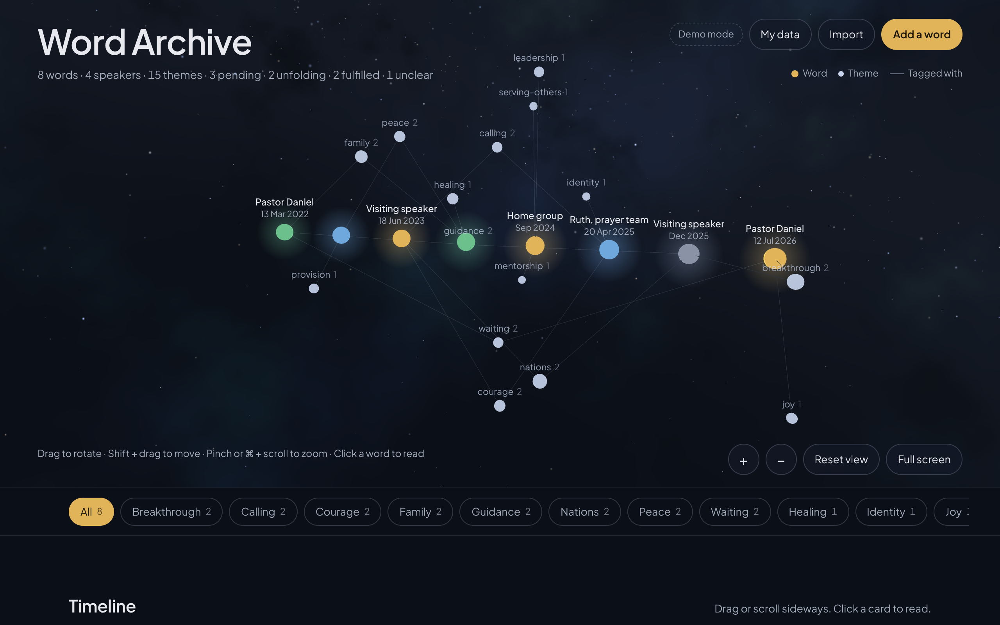
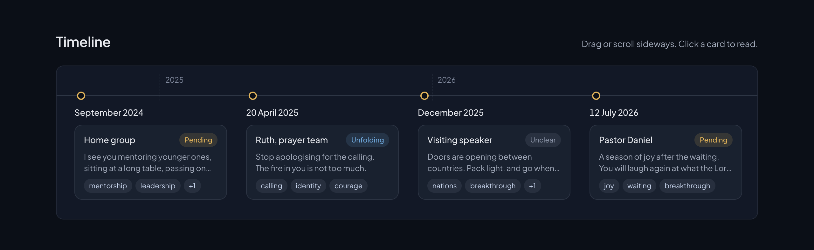
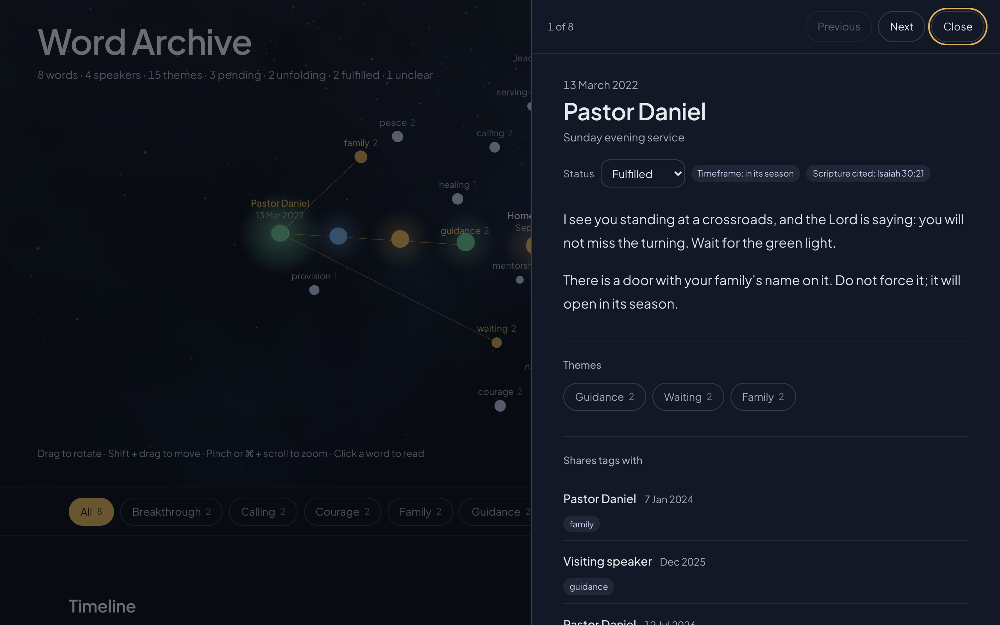
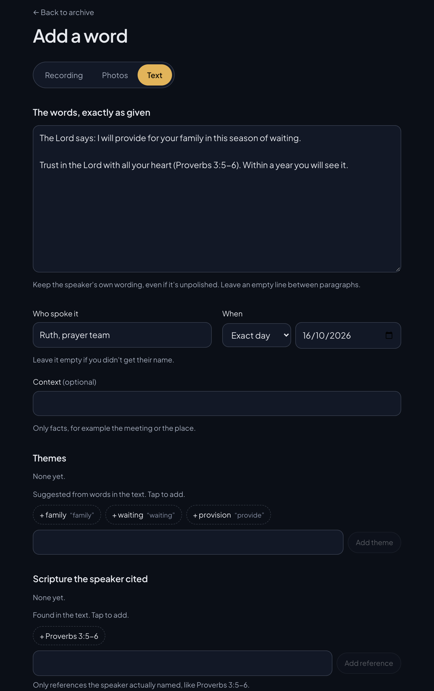
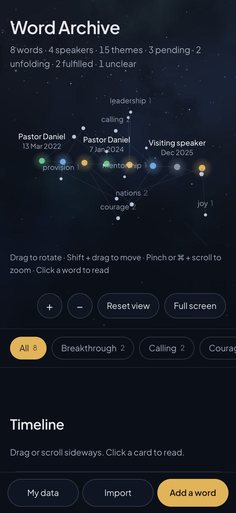

# Word Archive

Keep the prophetic words spoken over you, exactly as given, and see them together on a timeline and a map of shared themes.

**Free and open source** under the [MIT licence](LICENSE). Anyone may use it, run their own copy, change it and share it, at no cost. It works fully without any paid service; only the optional transcription uses credit on your own OpenRouter account.



## What it is for

Many Christians receive prophetic words: spoken over them in a service, at a prayer meeting or in a conversation. Those words end up scattered across voice memos, photos of notebook pages and notes apps. Years later, when it matters whether and how a word came to pass, they are hard to find and harder to see together.

Word Archive keeps them in one place:

- **Exactly as given.** Add a voice memo, a photo of your notes or typed text. The words are kept verbatim, with who spoke them, when and where.
- **On a timeline.** Every word in date order, even when you only remember the month or the year.
- **On a map of themes.** Words that share a theme (provision, calling, family and so on) are linked, so you can see what has been spoken more than once and by whom.
- **With your own follow-up.** Mark each word pending, unfolding, fulfilled or unclear, and add dated reflections as things happen.

**The app records, classifies and tags. It never interprets.** There are no AI summaries, meanings or "insights". Themes and scripture references are suggested from the words in the text itself, each showing the words that triggered it, and nothing is tagged until you choose it. Status and reflections are yours alone.

## Screenshots



**Timeline.** Every word in date order, with its status and themes. Drag or scroll sideways; click a card to read it.



**Reading a word.** The words as given, the status you set, the timeframe and scripture the speaker mentioned, and the other words it shares themes with.



**Adding a word.** Choose a recording, photos or text. Themes and scripture references are suggested from the text, each with the words that triggered it. Tap the ones that fit.



**On a phone.** The same archive works in a phone browser, with the main buttons along the bottom.

All screenshots use fictional sample words.

## Privacy

The content is religious-belief data, so the app is built to keep it close:

- **Everything stays in your browser.** Words, recordings and photos are stored on your device (IndexedDB). There is no account and nothing is uploaded.
- **One exception, only when you ask.** Tapping **Transcribe** sends that recording to be turned into text, after you agree, and only the text comes back. Every request demands a provider route that keeps nothing and doesn't train on the audio, and fails rather than going anywhere else.
- **Your data, your copy.** Export everything as a zip at any time, or delete everything for good.
- **No content in logs.** The server never stores or logs recordings, text or file names.

Because words live in one browser on one device, clearing site data, private browsing or another browser means a different, empty archive. Export to keep a copy.

## Run it yourself

You need [Node.js](https://nodejs.org) 22.12 or later. Clone or fork this repository, then in its folder:

```
npm install
npm run build
npm start
```

Then open http://localhost:3000. Press Control + C to stop.

### Deploy your own copy

It runs on [Vercel](https://vercel.com) as it is. Run `npm run deploy`: the first time, it asks you to log in to Vercel and to create or link a project. Server functions run in London (`vercel.json`).

### Turn on transcription (optional)

Transcription goes through [OpenRouter](https://openrouter.ai) with your own key. Without these settings the app works fully, and you paste or type the words yourself.

1. **Get an OpenRouter key.** Add a little credit (at about $0.003 per minute, $5 covers roughly 1,600 minutes). Under **Settings → Privacy**, switch off anything that lets providers train on or store inputs, and switch on "Zero Data Retention only". Create a key with a **credit limit**: that limit is the hard cap on what anyone can spend.
2. **Choose a tester code**, a short phrase you give to the people you invite. Anyone with the code can use the Transcribe button.
3. **Add the settings** as environment variables in your Vercel project (Production and Preview), or in a local `.env.local` file. Never commit them. See `.env.example`.
   - `OPENROUTER_API_KEY`: the key from step 1
   - `TESTER_CODE`: your phrase from step 2
   - `TRANSCRIBE_MODEL` (optional): defaults to `mistralai/voxtral-mini-transcribe`
4. **Deploy again**, because new settings only take effect in a new deployment.

If it says "Transcription is unavailable right now", OpenRouter has no private route (keeps nothing, no training) to that model at that moment. Switching to another model is one setting, `TRANSCRIBE_MODEL`.

## Known limits

- Reading text from photos isn't connected yet, so you type the words from a photo.
- Transcription goes through OpenRouter, a US company, before reaching the speech model. EU-only routing needs OpenRouter's paid Business plan.
- Very long recordings (near 60 minutes) need a lot of memory to prepare on a phone. If one fails, split it in Voice Memos first.
- The 3D view needs WebGL (every current desktop and phone browser has it).
- HEIC photos from iPhone may not display in Chrome; Safari shows them.
- English interface only. Words in any language are fine.

## For developers

- Rules: `CLAUDE.md`. Scope: `docs/SPEC.md` (transcription: §7 and §7c). Decisions: `docs/decisions.md`.
- Stack: Next.js (App Router, TypeScript). Storage sits behind one interface in `lib/store/` (`local` is the browser-only demo mode). AI adapters live in `lib/ai/`.
- `npm run check` runs typecheck, lint, unit tests, the production build and the end-to-end tests (`tests/e2e/`, fictional data only; the transcription test uses a fake OpenRouter server).
- Optional setting for testing: `OPENROUTER_BASE_URL`.

## Contributing

Suggestions, bug reports and pull requests are welcome. See [CONTRIBUTING.md](CONTRIBUTING.md).

## Licence

[MIT](LICENSE). You may use, copy, change, publish, share and even sell this software, for free, as long as the copyright and licence notice stay with it. It comes with no warranty.

The repository holds code, docs and fictional test data only: no one's words, recordings or keys.
